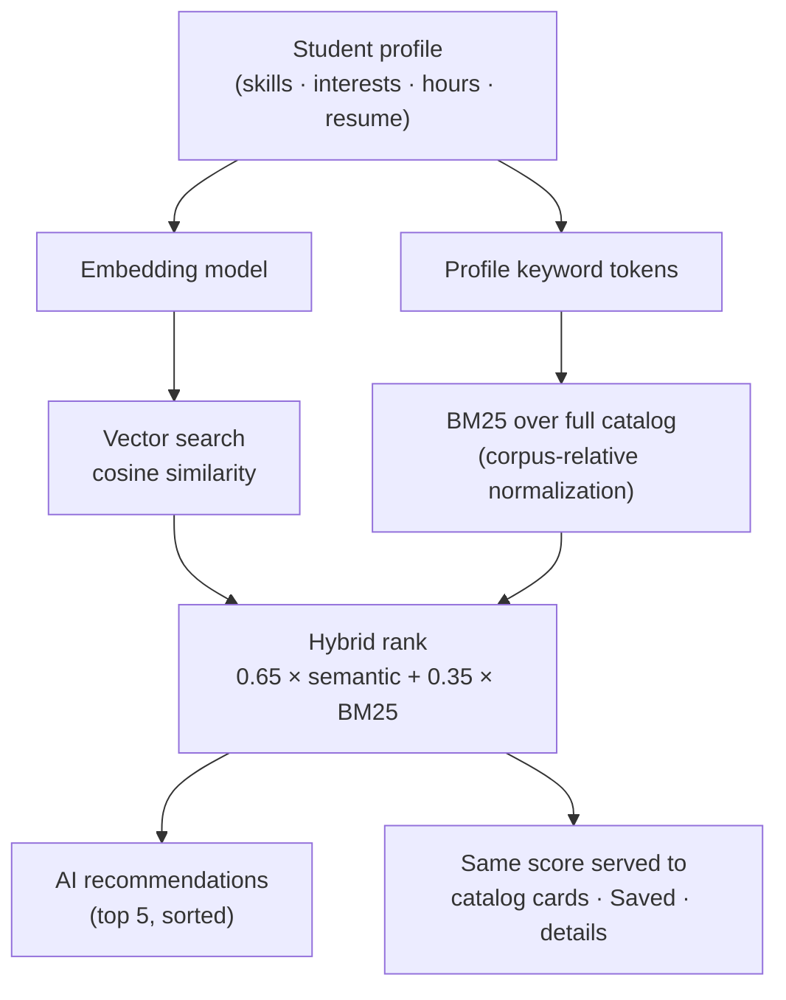

# LABBE

AI-powered research matching for USC: students get AI-ranked labs across every
department, faculty get AI-ranked, opted-in student candidates. Public landing
page and demo, email/password accounts (Better Auth on Convex). An independent
prototype — not an official USC service.

**Live demo:** https://labbe.pages.dev

## Run locally

Requires Node.js 24 and the pinned pnpm version.

```sh
pnpm install --frozen-lockfile
pnpm dev
```

Open `http://localhost:5173`. The landing page and public demo work without
Convex credentials; accounts need the backend configured (below).

| Route | Purpose |
| --- | --- |
| `/` | Public landing page |
| `/demo` | Explore fictional research data without an account |
| `/sign-up`, `/sign-in` | Create / access an account |
| `/app` | Signed-in student or faculty workspace |

## Configure Convex + Better Auth

```sh
# 1. Associate the backend with your Convex project and push functions
pnpm --filter @workspace/api-server exec convex dev

# 2. Set deployment env vars (generate the secret once per deployment)
pnpm --filter @workspace/api-server exec convex env set BETTER_AUTH_SECRET "$(openssl rand -base64 32)"
pnpm --filter @workspace/api-server exec convex env set SITE_URL http://localhost:5173

# 3. Point the frontend at the same deployment
cp artifacts/research-match/.env.example artifacts/research-match/.env.local
#   VITE_CONVEX_URL=https://your-deployment.convex.cloud
#   VITE_CONVEX_SITE_URL=https://your-deployment.convex.site
```

Only public URLs belong in `VITE_` variables; never put secrets there.
`.env.local` is git-ignored. Guide:
[Convex + Better Auth (React)](https://labs.convex.dev/better-auth/framework-guides/react).

## How matching works

Student matching is a hybrid ranker: semantic similarity from profile
embeddings fused with lexical BM25, computed over the full lab catalog.



| Surface | Formula |
| --- | --- |
| Backend (signed-in, live catalog) | `65%` vector similarity + `35%` BM25 (`discovery:projectScores`) |
| Faculty candidate ranking | Same hybrid score, project ↔ opted-in student (`faculty` compatibility) |
| Offline / public demo fallback | `40%` text cosine + `35%` skill coverage + `15%` hours + `10%` preferences, beginner/major adjustments (`src/lib/matching.ts`) |

BM25 is normalized against the strongest lexical match in the catalog, so all
surfaces score over the full corpus and the percentages stay comparable.

## Authentication and data boundaries

- Better Auth manages accounts/sessions in its Convex component; passwords are
  12–256 characters; reads/writes derive the owner from the validated session.
- A self-selected faculty preference does not verify faculty identity. Email
  verification and password reset are not configured — an email address is not
  proof of USC affiliation.
- Shortlists, interests, resume text, and demo matching are browser-local per
  account; they are not synced, published, or delivered, and students are never
  notified by shortlisting. Demo students' contact/résumé fields are hidden
  unless the demo student opts in.
- Live faculty discovery only shows students who opted in; consent is enforced
  server-side.

## Checks and CI

```sh
pnpm run typecheck && pnpm run typecheck:convex
pnpm test
pnpm --filter @workspace/research-match build
pnpm run analyze --base origin/main
```

CI (`.github/workflows/ci.yml`) runs TypeScript checks, auth-validation tests,
the web build, and a [Fallow](https://github.com/fallow-rs/fallow) changed-code
quality gate. `convex/_generated/` is committed so CI needs no credentials;
regenerate it with `convex codegen` after changing functions or schema.
`deploy-convex.yml` deploys Convex manually via the `production` environment.

## Project structure

- `artifacts/research-match` — React/Vite frontend.
- `artifacts/api-server` — Express status API and Convex functions.
- `lib/api-spec/openapi.yaml` — shared API contract (`pnpm --filter @workspace/api-spec codegen` after changes).
- `AGENTS.md` — full project brief and repository instructions.
- `docs/DATA_CONTRACT.md` — data contracts and source-of-truth rules.

Source: [MikeLuu99/research-match-hacksc](https://github.com/MikeLuu99/research-match-hacksc).
Never commit private student data, raw resumes, `.env.local`, or deployment keys.
